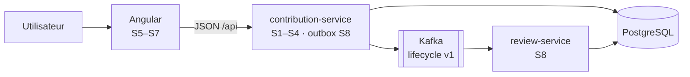

# Design — ACD Kata (S0 → S8)

Vue courte de ce qui est construit en S0–S8 : frontières, domaine, données, cas d'usage, séquences, événements, interface.

| Fichier | Contenu |
|---|---|
| [architecture.md](2-%20architecture.md) | Frontières, ports, garde-fous, exécution locale |
| [domain.md](3-%20domain.md) | Agrégat, machine à états, invariants |
| [data-model.md](4-%20data-model.md) | Tables, contraintes, concurrence, outbox, schéma review |
| [events.md](8-%20events.md) | Contrat, garanties, déduplication, métriques, rétention, pannes |
| [use-cases.md](5-%20use-cases.md) | Acteurs, cas d'usage, droits, contexte review |
| [sequences.md](6-%20sequences.md) | Création, transition, conflit, grille, versions, relais, consommation, purge, erreurs |
| [web.md](7-%20web.md) | Routes, composants, états, grille |

Périmètre : backend hexagonal (S1–S4), interface Angular (S5–S7), outbox, Kafka et contexte review (S8).

Deux règles de lecture :

- Les diagrammes sont du Mermaid : ils se rendent dans GitLab, VS Code et GitHub.
- En cas d'écart, le code et les tests font foi. Les décisions sont dans [docs/adr](../docs/adr/) et l'historique dans [journal.md](../journal.md).

