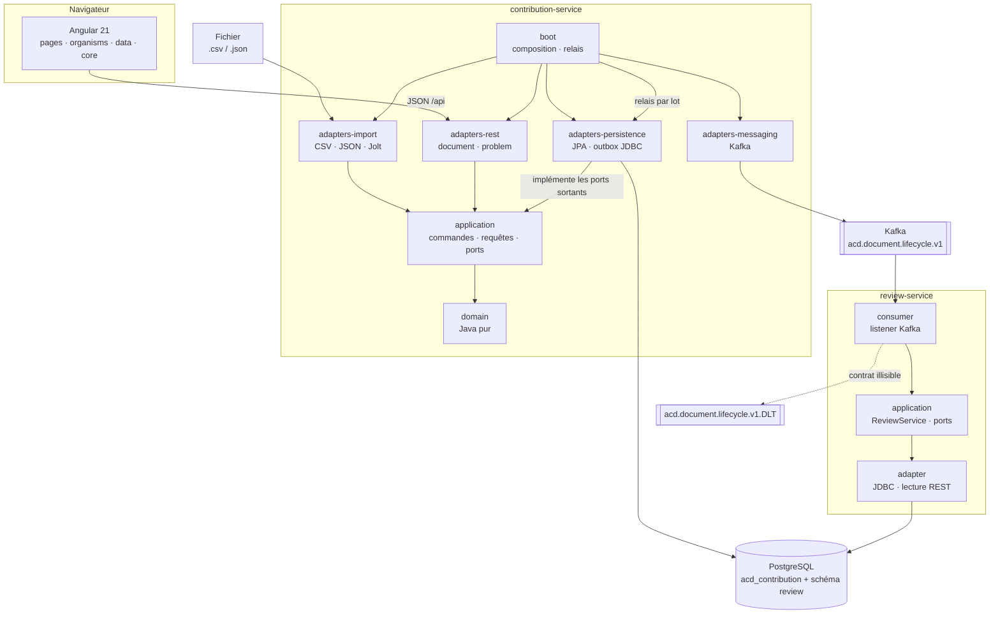
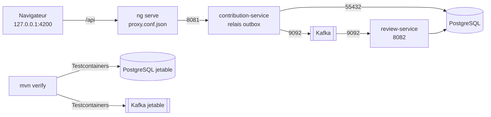

# Architecture

Deux applications, cinq frontières d'entrée pour la première, un broker entre elles. Le cœur reste en Java pur ; HTTP, fichiers, SQL et Kafka sont des adapters.

## Frontières

Flèche = dépendance de compilation ou appel.

## Modules

| Module | Rôle | Dépendances autorisées |
|---|---|---|
| `domain` | Agrégat, états, audit | JDK seulement |
| `application` | Cas d'usage, ports, modèles de lecture, événement de sortie | `domain`, JDK |
| `adapters-rest` | `document` (contrôleur, DTO), `problem` (erreurs) | `application`, Spring Web |
| `adapters-persistence` | Entités JPA, outbox JDBC, transactions | `application`, JPA, JDBC, PostgreSQL |
| `adapters-messaging` | Producteur Kafka, format du contrat | `application`, Spring Kafka |
| `adapters-import` | Lecteurs CSV/JSON, spécification Jolt, rapport de sortie | `application`, Jackson, Jolt |
| `boot` | Beans, horloge, ordonnanceur du relais | tous les adapters |
| `review-service` | Consommateur Kafka, tâches de revue | Spring Boot, Kafka, JDBC |

`review-service` est volontairement un seul module : il n'a pas de domaine riche, seulement une projection idempotente. Ses paquets séparent `application`, `consumer` et `adapter`.

## Ports

| Port | Service | Sens | Opérations |
|---|---|---|---|
| `DocumentCommands` | contribution | entrant | 8 commandes, rendent `DocumentDetail` |
| `DocumentQueries` | contribution | entrant | `get`, `search`, `version` |
| `DocumentImport` | contribution | entrant | `importDocuments` : un lot mappé, un rapport par ligne |
| `ImportSource` | contribution | sortant | `read` : fichier → enregistrements mappés et refus structurels |
| `DocumentSourceIndex` | contribution | sortant | `find`, `record` : la clé d'idempotence de l'import |
| `DocumentRepository` | contribution | sortant | `findById`, `add`, `save`, `search`, `exists`, `version` |
| `EventOutbox` | contribution | sortant | `append`, `claimDue`, `markPublished`, `markFailed`, `countPending`, `countFailed`, `purgePublishedBefore` |
| `EventPublisher` | contribution | sortant | `publish` |
| `Transactions` | les deux | technique | `inTransaction` : l'atomicité reste une décision applicative |
| `ReviewTasks` | review | sortant | `remember`, `advanceTo`, `openReview`, `decide` |

Tous les ports rendent des modèles applicatifs, jamais l'agrégat ([ADR 0003](../docs/adr/0003-application-read-model-and-atomic-ui.md)).

## Garde-fous exécutables

| Garde-fou | Vérifié par |
|---|---|
| Framework ou dépendance non-JDK dans `domain` | ArchUnit + Enforcer, avec fixtures en contre-exemple |
| `application` indépendante de `boot` | ArchUnit |
| Aucun adapter ne dépend d'un autre adapter | ArchUnit, y compris `messaging` et `importing` |
| Adapter → port, jamais → service concret | ArchUnit |
| Agrégat interdit dans l'adapter REST | ArchUnit |
| Implémentation de port hors `application`/adapters | ArchUnit |
| 100 % branches et lignes de `domain` et `application` | JaCoCo, échec du build |
| Cascade atomique de l'interface | `scripts/web-structure.test.mjs` |
| Format d'événement stable | contrat versionné + attentes du consommateur rejouées côté producteur |
| Rejeu sans effet | `ReviewTaskConsumerIT`, `JdbcEventOutboxIT` |
| Deux relais ne publient jamais le même événement | `twoRelaysNeverPublishTheSameEventTwice` |
| Retard et échecs observables | jauges `acd.outbox.pending` / `acd.outbox.failed`, vérifiées dans `OutboxPublicationIT` |
| L'outbox ne grossit pas sans fin | purge après rétention, testée en base |
| L'import n'invente aucun état | modes vérifiés commande par commande dans `DocumentImportServiceTest` |
| Rejouer un fichier ne crée rien | `JdbcDocumentSourceIndexIT`, `DocumentImportIT` |
| L'ordre des versions d'un document est publié | `claimsTheEventsOfOneDocumentInVersionOrderEvenWhenTheyShareATimestamp` |

## Volume de tests

| Niveau | Tests |
|---|---|
| Domaine | 18 |
| Application | 62 |
| Adaptateur d'import (mapping Jolt, golden files) | 15 |
| MVC (`@WebMvcTest`) | 55 |
| Persistance (Testcontainers) | 31 |
| Messagerie (unitaires, contrat, Kafka réel) | 9 |
| Architecture (ArchUnit) | 11 |
| HTTP de bout en bout | 11 |
| Contexte review | 16 |
| **Backend** | **228** |
| Interface (Vitest) | 40 |
| Structure de l'interface (Node) | 8 |

## Exécution locale

| Élément | Valeur |
|---|---|
| API contribution | `127.0.0.1:8081`, Swagger sur `/swagger-ui/index.html` |
| API review | `127.0.0.1:8082`, `GET /api/review-tasks` |
| Base locale | PostgreSQL 16.14, volume Compose, `make infra-up` |
| Broker local | Kafka 3.9.1 KRaft, un nœud, `127.0.0.1:9092` |
| Topics | `acd.document.lifecycle.v1`, `...v1.DLT` |
| Tests d'intégration | Testcontainers (PostgreSQL et Kafka), jamais l'infra Compose |
| Import en ligne de commande | `make import-documents`, spécifications dans `contracts/import` |
| Observation | `/actuator/health`, `metrics`, `prometheus` ; jauges `acd.outbox.pending`, `acd.outbox.failed` ; compteurs `published`, `purged` |

## Pile technique

| Couche | Choix | Version |
|---|---|---|
| Langage / build | Java, Maven Wrapper | 21, 3.9.16 |
| Framework | Spring Boot | 3.5.16 |
| Base / migrations | PostgreSQL, Liquibase | 16.14, 5.0.4 |
| Messagerie | Kafka, spring-kafka | 3.9.1, 3.3.x |
| Contrat HTTP | springdoc, export vérifié par test | 2.10.0, OpenAPI 3.0.1 |
| Contrat d'événement | fichier JSON versionné, comparé par test | v1 |
| Tests back | JUnit 5, AssertJ, ArchUnit, Testcontainers | — |
| Import | Jackson CSV, Jolt | 2.21.4, 0.1.8 |
| Front | Angular, Tailwind, AG Grid Community | 21.2.26, 3.4.19, 36.3.0 |
| Tests front | Vitest, `TestBed`, `HttpTestingController` | 4.1.12 |
