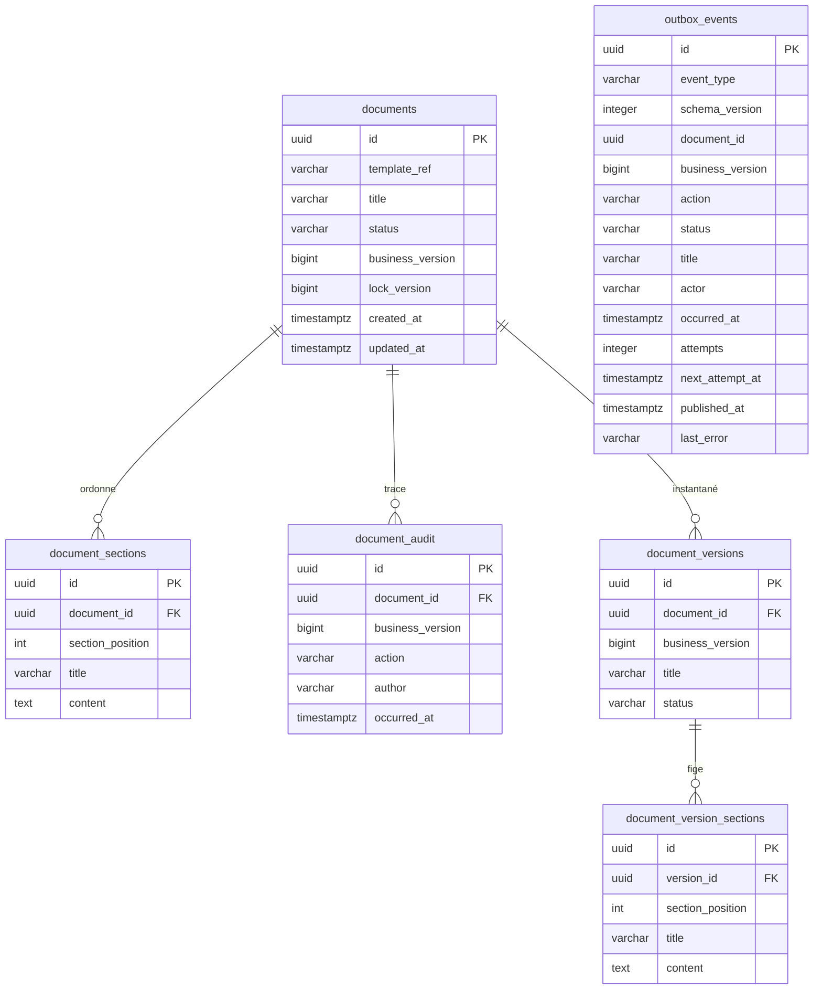
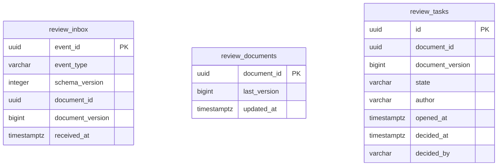
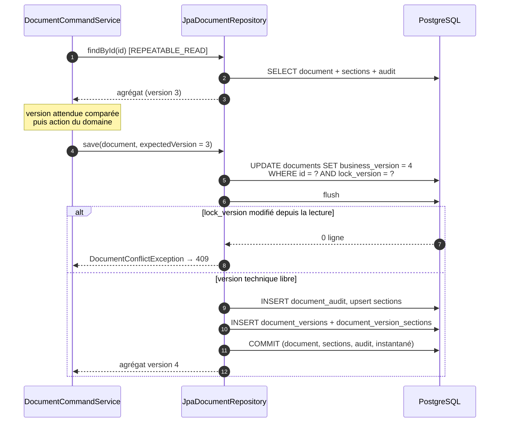

# Modèle de données

Neuf tables : six pour le document et son outbox, trois pour le contexte review. Les schémas sont créés par Liquibase ; Hibernate valide seulement.

`outbox_events` n'a pas de clé étrangère vers `documents` : un événement publié doit survivre à la suppression du document qu'il décrit.

## Trois lectures d'un même document

| Table | Répond à | Écrit quand |
|---|---|---|
| `documents` + `document_sections` | l'état courant | à chaque action |
| `document_audit` | qui a fait quoi et quand | à chaque action, dans l'agrégat |
| `document_versions` + `document_version_sections` | ce à quoi ressemblait le document une fois l'action réussie | à chaque action, par la persistance |
| `outbox_events` | quel événement doit partir au broker | à chaque action, dans la même transaction |

L'audit est du domaine ; l'instantané est une projection de persistance, ce qui dispense de rejouer l'historique pour lire une version.

## Contexte review

Schéma PostgreSQL `review`, même instance locale, propriété du second service.

| Table | Répond à | Garde |
|---|---|---|
| `review_inbox` | cet événement a-t-il déjà été traité ? | clé primaire sur `event_id` |
| `review_documents` | quelle version a déjà été appliquée ? | `ON CONFLICT DO UPDATE … WHERE last_version < EXCLUDED` |
| `review_tasks` | quelles revues sont ouvertes ? | `UNIQUE (document_id, document_version)` |

Aucune clé étrangère entre les deux schémas : les deux services ne partagent pas de données, seulement des événements.

## Correspondance domaine ↔ tables

| Domaine | Table | Remarque |
|---|---|---|
| `Document` | `documents` | `business_version` = version métier |
| `Document.sections` | `document_sections` | ordre par `section_position` |
| `Document.auditTrail` | `document_audit` | ordre par `business_version` |
| `DocumentStatus` | `status` varchar | `CHECK` sur les 7 valeurs, pas un type Postgres |
| `DocumentAction` | `action` varchar | `CHECK` sur les 8 valeurs |
| `Actor` | `author` varchar(100) | auteur pédagogique, sans authentification |

`lock_version` est technique : il ne sort jamais de l'adapter.

## Contraintes

| Contrainte | But |
|---|---|
| FK `document_id` → `documents(id)` `ON DELETE CASCADE` | pas d'enfant orphelin |
| FK `version_id` → `document_versions(id)` `ON DELETE CASCADE` | pas de section d'instantané orpheline |
| `UNIQUE (document_id, section_position)` | ordre sans doublon |
| `UNIQUE (document_id, business_version)` sur `document_audit` | un audit par version |
| `UNIQUE (document_id, business_version)` sur `document_versions` | un instantané par version |
| `UNIQUE (version_id, section_position)` | ordre figé sans doublon |
| `CHECK business_version >= 1` | version positive |
| `CHECK updated_at >= created_at` | temps cohérent |
| `CHECK length(content) <= 100000` | limite du domaine en base |
| Index `(status, updated_at DESC, id)` | filtre statut + tri par défaut |
| Index `(updated_at DESC, id)` | tri par défaut sans filtre |

Les documents antérieurs à l'instantané gardent l'image de leur version courante (changeset 002). Leurs versions précédentes ne sont pas reconstruites : `GET /versions/{n}` répond `404` pour elles.

## Écriture et concurrence

Trois protections complémentaires :

- applicative : `document.version() != expectedVersion` → conflit avant toute écriture ;
- base : `lock_version` en compare-and-set, qui couvre la course entre deux écritures simultanées ;
- transaction : état courant, audit et instantané validés ensemble ou pas du tout.

Le `UPDATE` de la racine est envoyé **avant** le chargement des collections : un écrivain concurrent produit un conflit, jamais un agrégat composé de deux versions.

## Règles du relais

| Règle | Effet |
|---|---|
| `ORDER BY occurred_at, id LIMIT n` avec `FOR UPDATE SKIP LOCKED` | deux relais prennent des lots disjoints |
| Claim = `next_attempt_at = now() + bail` | un relais mort libère son lot à l'expiration |
| Échec = `attempts + 1`, `last_error`, `next_attempt_at = now() + backoff` | reprise différée, plafonnée à 5 minutes |
| Succès = `published_at` renseigné | la ligne ne sera plus réclamée |
| Purge = `DELETE … WHERE published_at < now() - rétention` | la table reste bornée ; un non-publié n'est jamais supprimé |

Les événements publiés restent 7 jours par défaut (configurable), puis sont supprimés : assez pour enquêter après incident, borné pour ne pas transformer une file en archive.

## Règles de lecture

| Opération | Isolation | Charge |
|---|---|---|
| `get` | `REPEATABLE_READ` | racine + sections + audit |
| `version` | `REPEATABLE_READ` | une ligne d'audit + un instantané |
| `search` | `REPEATABLE_READ` | projection seulement, aucune collection |

Le total et les lignes d'une recherche partagent les mêmes prédicats : statut, `q` littéral sur le titre (insensible à la casse, `%` et `_` échappés), fenêtre `[startRow, endRow[` de 1 à 500 lignes.
