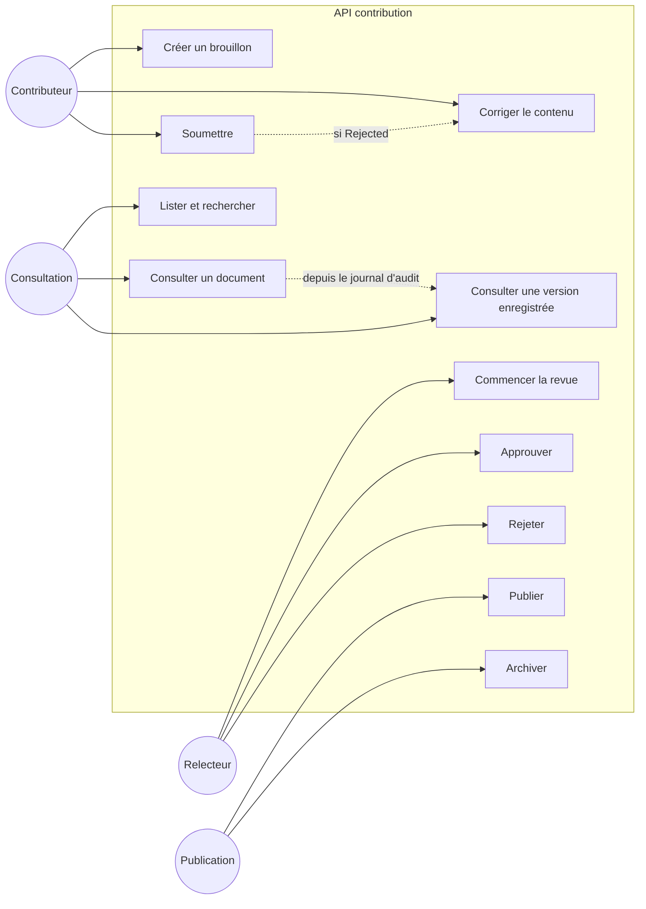
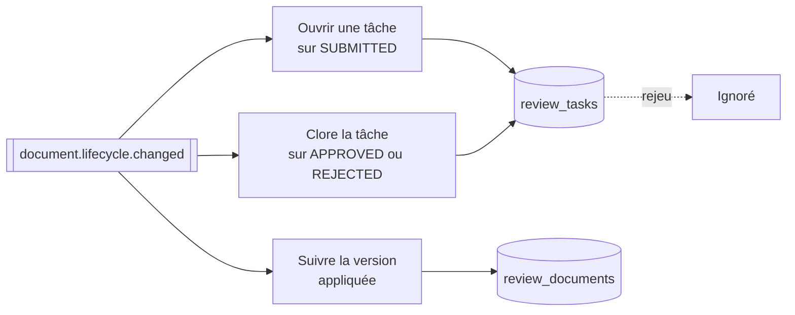

# Cas d'usage

Un seul humain dans le kata, plusieurs rôles fonctionnels. Aucune authentification : `X-User` est un auteur pédagogique, et la machine à états est la seule barrière.

## Détail

| Cas d'usage | Écran | API | Condition |
|---|---|---|---|
| Créer un brouillon | `/documents/new` | `POST /api/documents` | titre et modèle non vides |
| Corriger le contenu | `/documents/{id}` | `PUT /api/documents/{id}/content` | statut `Draft` ou `Rejected` |
| Soumettre | `/documents/{id}` | `POST .../submit` | `Draft` ou `Rejected`, ≥ 1 section non vide |
| Commencer la revue | `/documents/{id}` | `POST .../start-review` | `Submitted` |
| Approuver | `/documents/{id}` | `POST .../approve` | `InReview` |
| Rejeter | `/documents/{id}` | `POST .../reject` | `InReview` |
| Publier | `/documents/{id}` | `POST .../publish` | `Approved` |
| Archiver | `/documents/{id}` | `POST .../archive` | `Published` |
| Lister et rechercher | `/documents` | `GET /api/documents` | — |
| Consulter un document | `/documents/{id}` | `GET /api/documents/{id}` | — |
| Consulter une version enregistrée | `/documents/{id}` | `GET /api/documents/{id}/versions/{version}` | version écrite après la migration 002 |

Toute mutation d'un document existant exige `expectedVersion` : la version métier lue avant l'action.

## Ce que le front fait et ne fait pas

| Le front fait | Le front ne fait pas |
|---|---|
| Masque les actions illégales du statut | Décider qu'une soumission est valide |
| Valide les formats (longueurs, champs vides) | Remplacer la validation du serveur |
| Affiche le `code` et le `detail` du `ProblemDetail` | Traduire un 409 en règle inventée |
| Recharge sur `VERSION_CONFLICT` | Résoudre le conflit à la place de l'utilisateur |
| Affiche une version stockée à la demande | Rejouer l'historique côté client |

## Contexte review

Aucun acteur humain ne déclenche ces cas d'usage : ils sont provoqués par les événements du contexte contribution.

| Cas d'usage | Déclencheur | Effet |
|---|---|---|
| Ouvrir une tâche de revue | `SUBMITTED` | une ligne `PENDING` par version soumise |
| Clore la tâche | `APPROVED` ou `REJECTED` | état et décideur enregistrés |
| Suivre la version | toute action | `last_version` avance, jamais ne recule |
| Consulter les tâches | humain, `GET /api/review-tasks` | lecture seule |

Ce que le contexte review ne fait pas : décider du statut d'un document, écrire dans les tables du contexte contribution, rejouer le cycle de vie ([ADR 0005](../docs/adr/0005-review-context-ownership.md)).

## Hors périmètre S0–S8

Authentification, autorisation par rôle, publication externe, notifications, décision distribuée. Voir [roadmap](../docs/roadmap.md) S9+.
