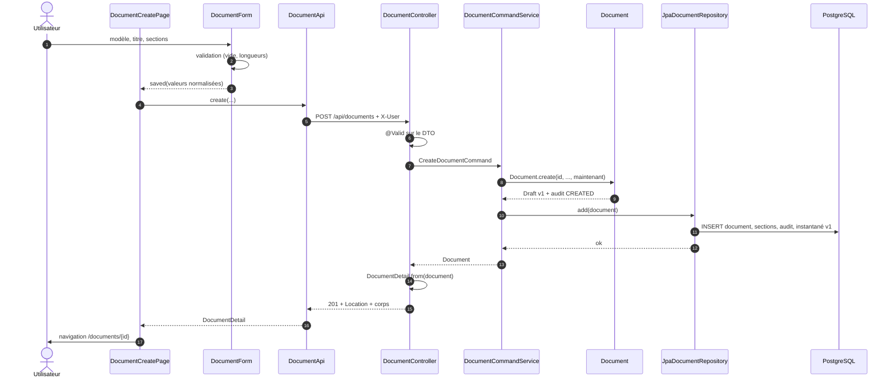
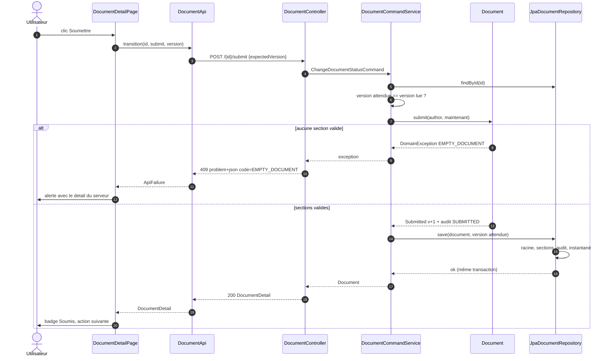
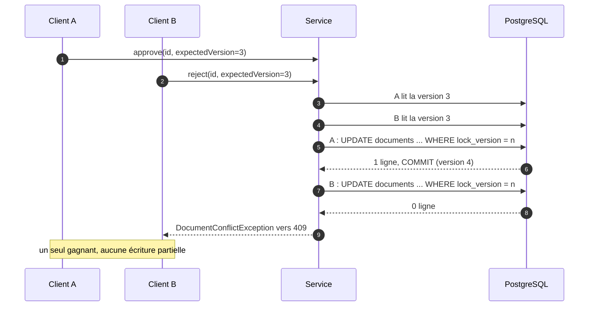
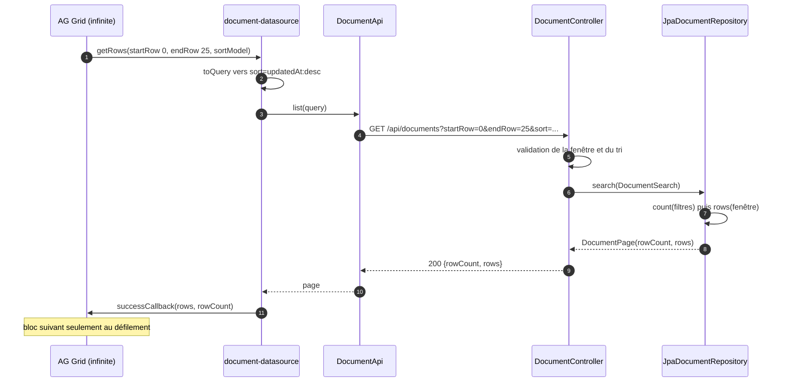
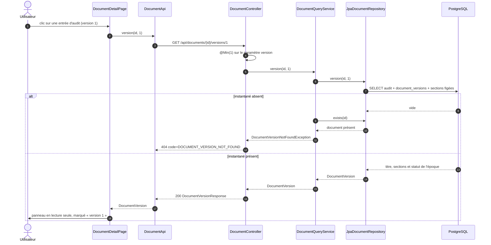
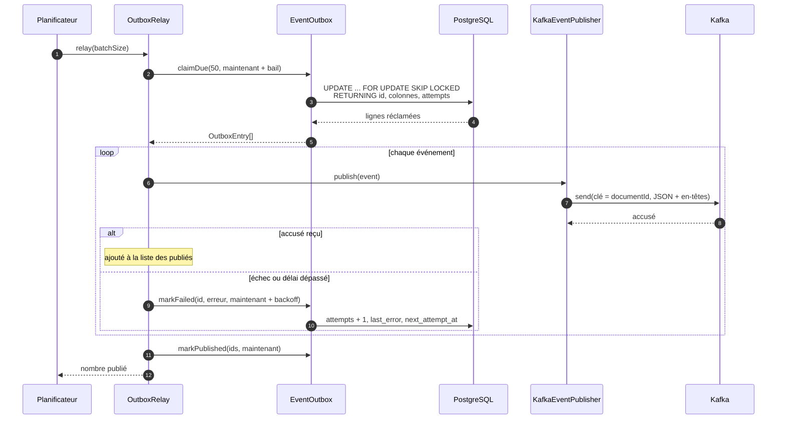
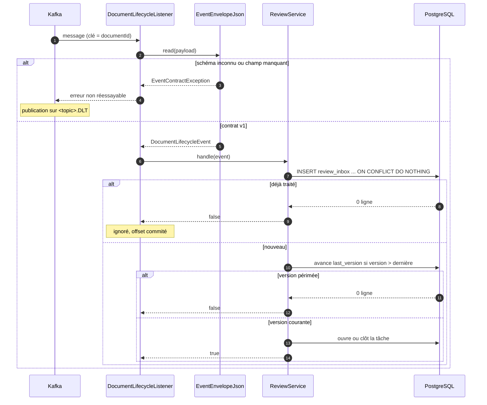
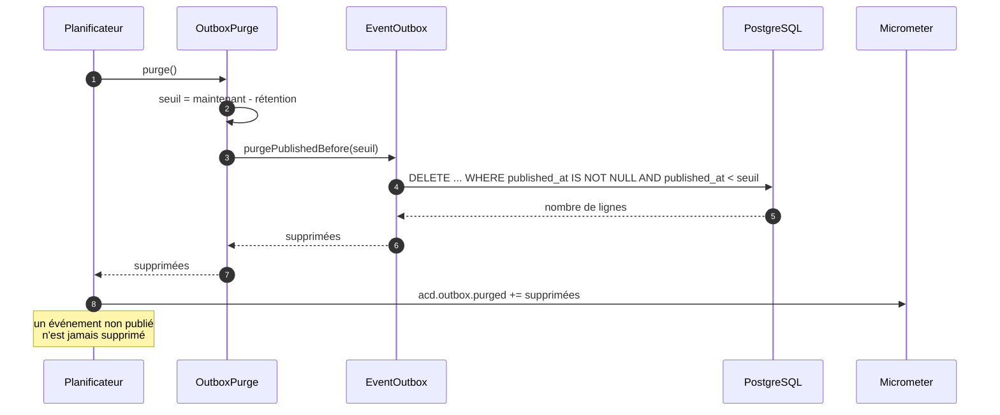
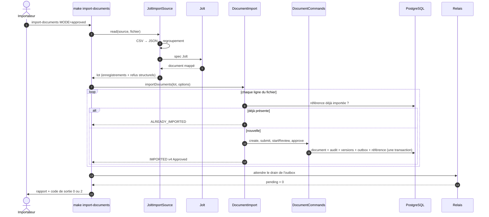
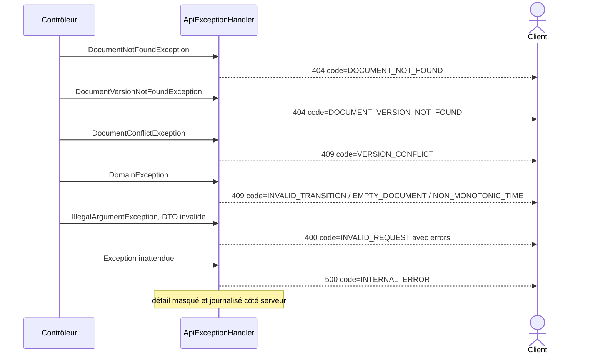

# Séquences

Dix parcours qui expliquent le comportement réel.

## 1. Créer un brouillon depuis l'interface

## 2. Soumettre, avec la règle métier

## 3. Deux écrivains concurrents

Le perdant ne laisse ni section, ni audit, ni instantané : les quatre écritures sont dans une transaction.

## 4. Charger un bloc de grille

Un tri d'en-tête relance ce cycle une fois. Un changement de filtre de la barre d'outils purge les blocs avant de relancer.

## 5. Lire une version enregistrée

La version courante reste affichée en haut : le panneau montre des valeurs figées, pas un formulaire.

## 6. Publier un événement par le relais

Un relais interrompu avant la publication ne perd rien : le bail expire et le lot est repris. C'est la raison de la déduplication côté consommateur.

## 7. Consommer un événement sans effet dupliqué

## 8. Purger les événements publiés

## 9. Importer un fichier

## 10. Traduire une erreur en problème HTTP

Toutes les réponses d'erreur sont en `application/problem+json` avec un `code` stable, utilisé par l'interface.
