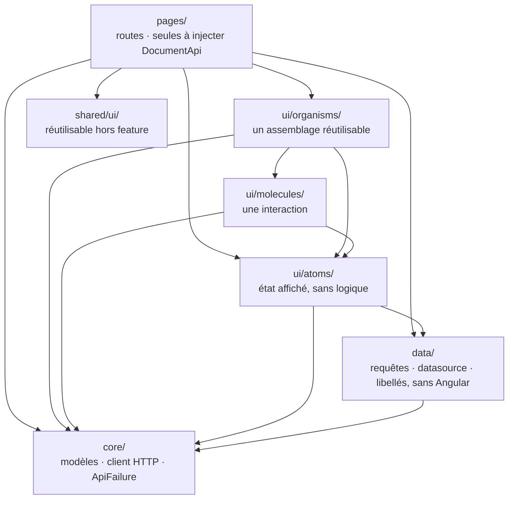
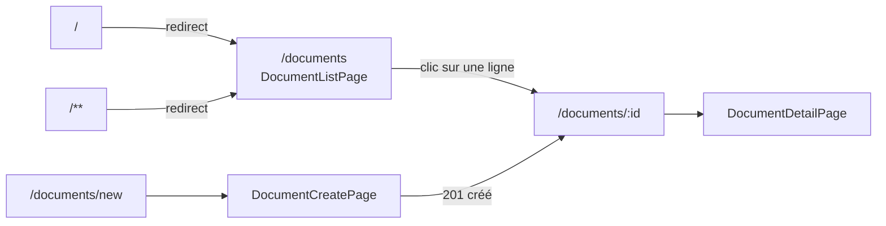
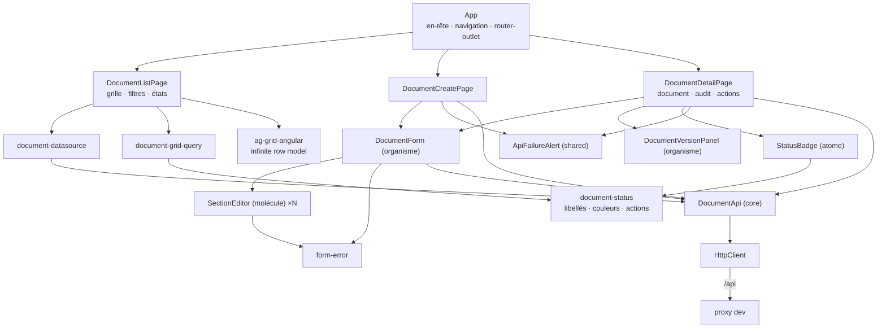
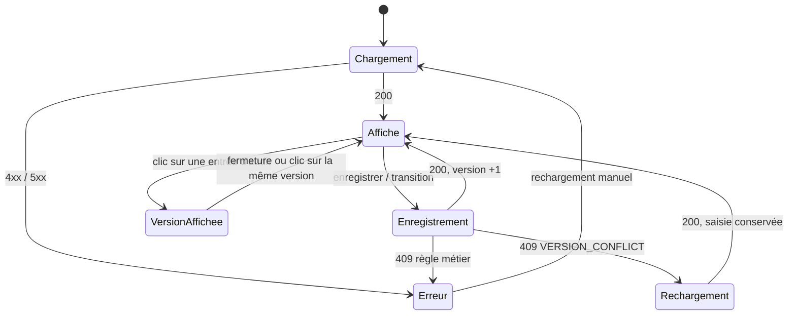

# Interface web

Angular 21 standalone, zoneless, sans `NgModule`. Signals pour l'état, `HttpClient` pour les appels, structure atomique imposée par un test.

## Cascade des couches

`ui/form-error.ts` vit à la racine de `ui/` parce qu'une molécule et un organisme le lisent. Seules la coquille et `app.routes.ts` traversent les features.

## Routes

Chaque page est chargée en *lazy* : le bundle initial ne contient ni AG Grid ni le formulaire.

## Composants

La grille n'utilise pas l'atome de badge : elle colore ses cellules avec les mêmes libellés et tons fournis par `data/document-status`.

## État du détail

| Signal | Rôle |
|---|---|
| `loading` | chargement initial |
| `failure` | `ApiFailure` (code + detail) affiché en `role="alert"` |
| `notice` | succès ou conflit, `aria-live="polite"` |
| `busy` | action en cours, boutons désactivés |
| `document` | document courant, source de `expectedVersion` |
| `actions` | actions autorisées par le statut |
| `editable` | `Draft` ou `Rejected` |
| `selectedVersion`, `versionLoading`, `versionFailure` | panneau d'une version figée |

## Grille

| Réglage | Valeur | Raison |
|---|---|---|
| Modèle | `infinite` (Community) | le SSRM est Enterprise ; le contrat local est celui de la fenêtre |
| Taille de bloc | 25 | une requête par bloc, total exact pour la barre |
| Tri | `title`, `updatedAt`, `status`, `version` | seuls champs acceptés par l'API |
| Filtres | statut + `q` sur le titre | seuls filtres que le contrat expose |
| Tri inconnu | `updatedAt:desc` | évite un 400 depuis une colonne non triable |
| Thème | `themeQuartz` (Theming API) | aucun CSS de thème à importer |

## Règles vérifiées par `scripts/web-structure.test.mjs`

| Règle | Interdit |
|---|---|
| `data` reste sans UI | `data/` → `pages/`, `ui/`, `shared/` |
| `atoms` en bas de cascade | `atoms/` → `molecules/`, `organisms/`, `pages/`, `shared/` |
| `molecules` sous `organisms` et `pages` | `molecules/` → `organisms/`, `pages/` |
| `organisms` sans `pages` | `organisms/` → `pages/` |
| `core` ignore la feature | `core/` → `features/`, `shared/`, `app.*` |
| `shared` ignore la feature | `shared/` → `features/`, `app.*` |
| Traversée des features | tout fichier hors `features/` sauf `app.routes.ts` |
| Imports relatifs | chaque chemin doit résoudre vers un fichier existant |

Exécuté par `make web-structure-test` et par `make verify` (8 tests).

## Fichiers

| Fichier | Rôle |
|---|---|
| `core/models/document.model.ts` | types du contrat |
| `core/api/document-api.ts` | client HTTP typé, `X-User` sur les mutations |
| `core/api/api-failure.ts` | `ProblemDetail` → statut, code, détail |
| `shared/ui/molecules/api-failure-alert.ts` | alerte d'erreur réutilisable |
| `features/documents/data/document-grid-query.ts` | tri AG Grid → `sort=champ:direction` |
| `features/documents/data/document-datasource.ts` | `IDatasource` de l'infinite row model |
| `features/documents/data/document-status.ts` | libellés, tons, actions autorisées |
| `features/documents/ui/atoms/status-badge.ts` | badge d'un statut |
| `features/documents/ui/molecules/section-editor.ts` | une section du formulaire |
| `features/documents/ui/organisms/document-form/` | formulaire complet |
| `features/documents/ui/organisms/document-version-panel.ts` | valeurs figées d'une version |
| `features/documents/pages/` | trois routes, seules à injecter `DocumentApi` |

## Décisions

| Sujet | Choix | Alternative écartée |
|---|---|---|
| Chargement | `HttpClient` + signals explicites | `resource()` : remplacé par un `IDatasource` en S6 |
| Erreurs | afficher `code` et `detail` du serveur | reconstruire un message local |
| Règles | le domaine décide, le front masque | dupliquer la validation métier |
| CORS | proxy de développement | configuration CORS serveur |
| Structure | cascade atomique vérifiée en Node | ESLint `no-restricted-imports` |
| Tests | `TestBed` + `HttpTestingController` | Angular Testing Library |
