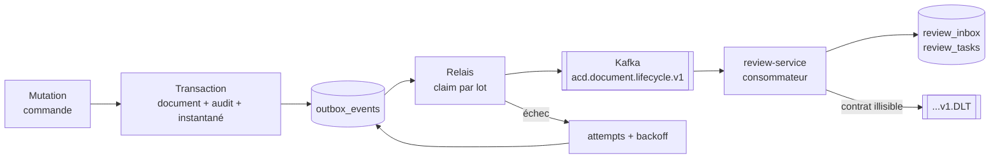
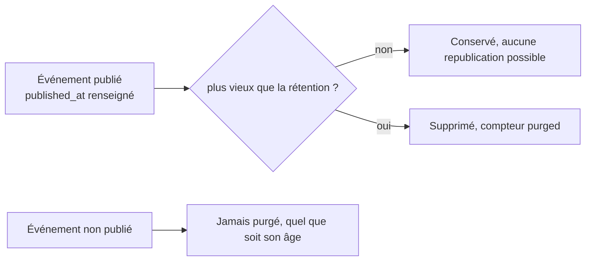
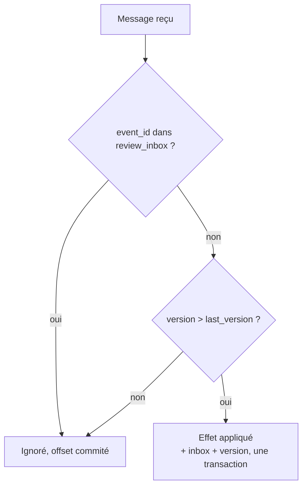
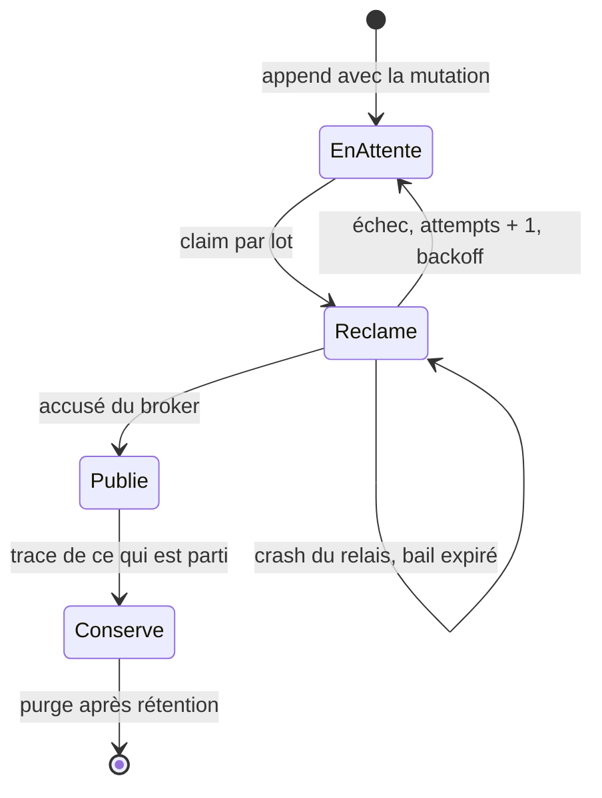

# Événements

Un événement par mutation, écrit avec elle, publié après elle, consommé au moins une fois.

## Chaîne complète

## Contrat v1

Fichier de référence : [`contracts/events/document-lifecycle-changed-v1.json`](../contracts/events/document-lifecycle-changed-v1.json).

| Champ | Type | Rôle |
|---|---|---|
| `eventId` | uuid | identité de l'événement, base de la déduplication |
| `type` | string | `document.lifecycle.changed` |
| `schemaVersion` | int | version du contrat, 1 aujourd'hui |
| `occurredAt` | instant ISO | horodatage de la mutation, pas de la publication |
| `documentId` | uuid | clé Kafka : ordre par document |
| `documentVersion` | long | version métier après la mutation |
| `action` | enum | `CREATED`, `CONTENT_UPDATED`, `SUBMITTED`, … |
| `status` | enum | statut atteint |
| `title` | string | titre courant |
| `actor` | string | auteur pédagogique |

Ajouter un champ, en renommer un ou en retirer un change la version et le topic. Un test compare le JSON produit au fichier : la modification silencieuse casse le build.

## Garanties

| Garantie | Comment | Vérifié par |
|---|---|---|
| Pas d'événement sans mutation validée | écriture dans la même transaction | `rollsBackTheDocumentChangeWhenTheOutboxRejectsTheEvent` |
| Pas de mutation sans événement | l'append échoue, la transaction annule | même test |
| Pas de doublon en base | `UNIQUE (document_id, business_version)` | `refusesTwoEventsForTheSameDocumentVersion` |
| Ordre par document | clé = `documentId`, une partition par clé | `keepsTheEventsOfOneDocumentInVersionOrderOnOnePartition` |
| Reprise après crash du relais | bail dans `next_attempt_at`, `FOR UPDATE SKIP LOCKED` | `claimsAnEventOnceThenAgainOnlyAfterTheLeaseExpires` |
| Deux relais sans recouvrement | claim `SKIP LOCKED` | `aSecondRelaySkipsEventsBeingClaimedByAnother` |
| Livraison au moins une fois | échec → `attempts`, backoff plafonné | `OutboxRelayTest` |
| Rejeu sans effet | inbox + garde de version | `ReviewTaskConsumerIT` |
| Message illisible non bloquant | `DLT` immédiate pour un contrat non supporté | `ReviewTaskConsumerIT` |
| Deux relais en parallèle | chacun publie des événements distincts | `twoRelaysNeverPublishTheSameEventTwice` |
| La table ne grossit pas sans fin | purge des événements publiés hors rétention | `reportsPendingAndFailedCountsAndPurgesOnlyPublishedEvents…` |

**Ce qui n'est pas garanti** : exactly-once de bout en bout. Un événement peut être publié deux fois ; c'est le consommateur qui rend la répétition inoffensive.

## Contrat piloté par le consommateur

Le consommateur publie ses attentes dans [`contracts/events/expectations/`](../contracts/events/expectations) : un fichier par comportement, avec la charge utile attendue et l'effet attendu (`OPEN_TASK`, `DECIDE`, `IGNORE`, `REJECT`).

| Côté | Test | Ce qu'il fait |
|---|---|---|
| Consommateur | `ConsumerContractTest` | lit chaque attente, la passe au vrai parseur et au vrai service, vérifie l'effet déclaré |
| Producteur | `EventContractCompatibilityTest` | rejoue chaque attente à travers son propre domaine et son sérialiseur, vérifie que le message émis porte les champs déclarés |

Renommer un champ côté producteur casse la vérification, pas le consommateur : la compatibilité est prouvée avant le déploiement, pas découverte en production. Les attentes sans scénario producteur (schéma inconnu, événement périmé) ne concernent que le consommateur.

## Observation

| Métrique | Type | Signification |
|---|---|---|
| `acd.outbox.pending` | jauge | événements écrits, non publiés |
| `acd.outbox.failed` | jauge | non publiés après au moins un échec |
| `acd.outbox.published` | compteur | événements acceptés par le broker |
| `acd.outbox.purged` | compteur | événements supprimés après rétention |

Un `pending` qui monte alors que `failed` reste à zéro indique un relais à l'arrêt ; les deux qui montent indiquent un broker qui refuse. Sans ces jauges, une panne Kafka serait invisible : c'était la faiblesse du premier jet.

## Rétention

Rétention par défaut : 7 jours, purge horaire (`acd.outbox.purge.*`). Un événement non publié n'est jamais supprimé — ce serait perdre une mutation.

## Déduplication

Les deux gardes sont des instructions SQL uniques (`ON CONFLICT`), donc valables même avec plusieurs consommateurs en parallèle.

## États d'un événement

## Pannes

| Panne | Effet | Reprise |
|---|---|---|
| Broker indisponible | les mutations continuent, l'outbox grossit | le relais reprend au retour du broker |
| Relais arrêté au milieu d'un lot | événements réclamés, non publiés | à l'expiration du bail, un autre relais les reprend |
| Base du consommateur indisponible | offset non commité | Kafka rejoue, la déduplication protège |
| Message au contrat inconnu | `DLT` après deux essais | relecture manuelle, la partition continue |
| Redémarrage du consommateur | rejeu possible du dernier lot | inhérent à l'at-least-once, sans effet |

## Hors périmètre S8

Exactly-once, compaction et rétention des topics Kafka, registre de schémas centralisé, broker Pact, saga. Les raisons sont dans [la fiche S8](../docs/phases/S8-events.md).
