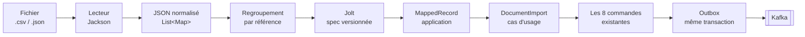
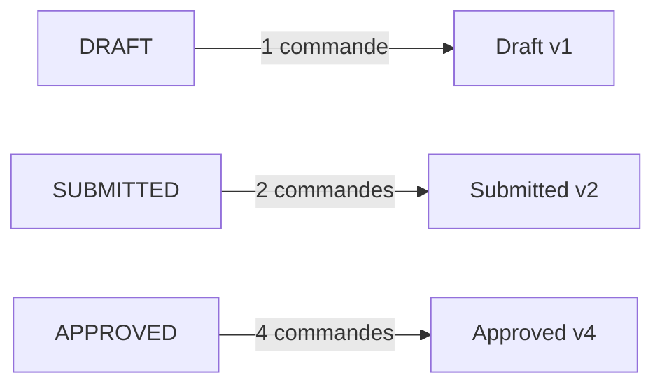
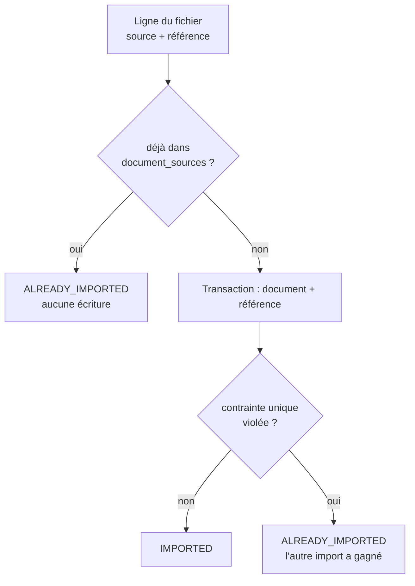

# Import de fichiers

Un fichier décrit des documents et demande jusqu'où les amener. Rien de plus : l'import réutilise
les commandes existantes, il n'ajoute ni état ni transition.

## Chaîne



Le CSV est normalisé en JSON parce que Jolt ne lit que du JSON, et le regroupement se fait avant lui
parce que Jolt met en forme un objet, il ne regroupe pas de lignes.

## Mode demandé



| Mode | Commandes | Audit | Événements | Tâche de revue |
|---|---|---|---|---|
| `DRAFT` | `create` | 1 | 1 | aucune |
| `SUBMITTED` | `create`, `submit` | 2 | 2 | ouverte |
| `APPROVED` | `create`, `submit`, `startReview`, `approve` | 4 | 4 | ouverte puis décidée |

« Approuver directement » veut donc dire : traverser les quatre étapes en une commande de terminal,
pas sauter trois d'entre elles.

## Contrat de mapping

Un dossier par source, versionné avec le code :

```
contracts/import/annuaire/
  mapping.jolt.json   # colonnes du fichier -> champs du document
  sample.csv          # une ligne par section
  expected.json       # ce que le mapping doit produire, ligne par ligne
```

| Fichier | Rôle | Vérifié par |
|---|---|---|
| `mapping.jolt.json` | projection des noms externes vers les nôtres, plus les valeurs par défaut | `JoltImportSourceTest` (échantillon → sortie attendue) |
| `sample.csv` | forme réelle du fichier, y compris deux sections pour un document | même test |
| `expected.json` | sortie exacte, références et numéros de ligne compris | même test |

Remplacer un mapping ne demande pas de recompiler : la spécification est lue depuis
`acd.import.specs-directory` à chaque import. C'est ce qui rend la promesse « le mapping est une
donnée » vraie au lieu d'être décorative.

## Idempotence



| Règle | Conséquence |
|---|---|
| `UNIQUE (source_name, source_reference)` | rejouer un fichier ne crée rien |
| référence écrite dans la transaction du document | jamais de document non tracé |
| référence absente refusée | pas de doublon silencieux |
| la même référence dans deux sources reste possible | deux provenances distinctes, deux documents |

## Rapport

Une ligne par enregistrement du fichier, dans l'ordre des lignes, avec le code du domaine quand il y
en a un :

| Colonne | Sens |
|---|---|
| `line`, `reference` | où c'est dans le fichier |
| `status` | `IMPORTED`, `PLANNED`, `ALREADY_IMPORTED`, `REJECTED` |
| `documentId`, `version`, `documentStatus` | où c'est dans l'application |
| `code`, `detail` | pourquoi c'est refusé, sans réécriture du message du domaine |

Le lot n'est pas atomique : une ligne refusée n'annule pas les autres, et c'est le rapport qui porte
la vérité. En ligne de commande, le code de sortie vaut `2` dès qu'une ligne est refusée.

## Observation

| Signal | Où |
|---|---|
| événements en attente après un import | jauge `acd.outbox.pending`, drainée par la commande avant de rendre la main |
| tâches ouvertes par l'import | `GET /api/review-tasks?state=PENDING` |
| ce qui a été importé et quand | table `document_sources`, colonne `recorded_at` |
| trace complète d'un import | fichier `target/import-report.json` |

## Hors périmètre

File d'attente et reprise après incident, rollback de fichier, Excel ou XML, envoi de fichier depuis
l'interface, spécifications téléversées à l'exécution. Les limites de débit et de taille sont dans
[la fiche E1](../docs/phases/E1-import.md).
