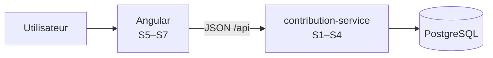

# Design — ACD Kata (S0 → S7)

Vue courte de ce qui est construit en S0–S7 : frontières, domaine, données, cas d'usage, séquences, interface.

| Fichier | Contenu |
|---|---|
| [architecture.md](architecture.md) | Frontières, dépendances, ports, exécution locale |
| [domain.md](domain.md) | Agrégat, machine à états, invariants |
| [data-model.md](data-model.md) | Tables, contraintes, concurrence |
| [use-cases.md](use-cases.md) | Acteurs, cas d'usage, droits |
| [sequences.md](sequences.md) | Création, transition, conflit, bloc de grille, version lue, erreurs |
| [web.md](web.md) | Routes, composants, états, grille |

Périmètre : backend hexagonal (S1–S4), interface Angular, grille et formulaire (S5–S7), y compris le modèle de lecture applicative et les instantanés de version.

Deux règles de lecture :

- Les diagrammes sont du Mermaid : ils se rendent dans GitLab, VS Code et GitHub.
- En cas d'écart, le code et les tests font foi. Les décisions sont dans [docs/adr](../docs/adr/) et l'historique dans [journal.md](../journal.md).

