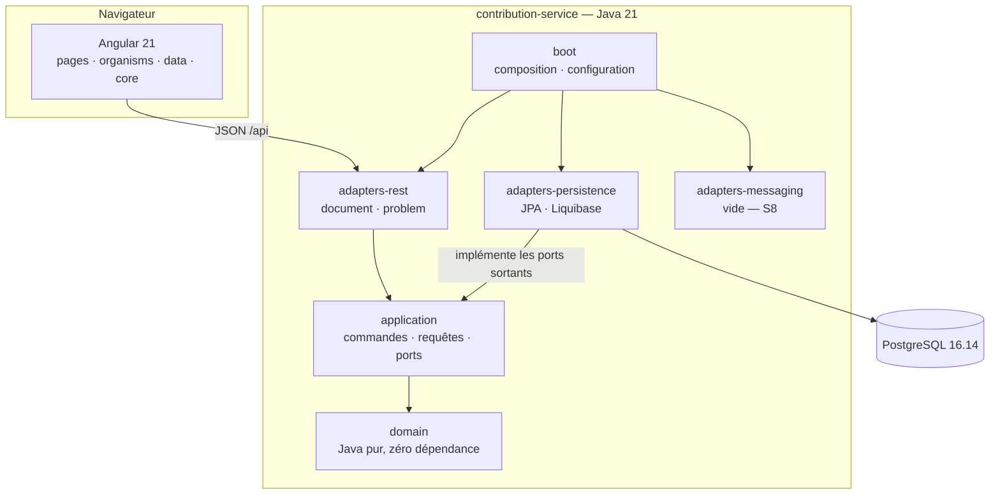
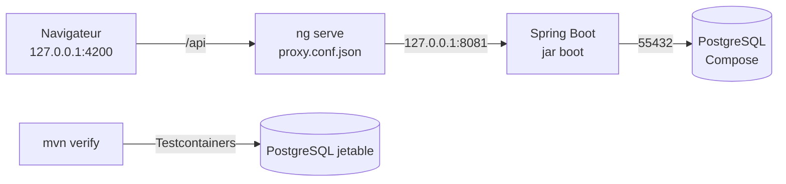

# Architecture

Deux applications, quatre frontières. Le cœur est en Java pur ; HTTP et SQL sont des adapters ; `boot` compose.

## Frontières

Flèche = dépendance de compilation ou appel.

## Modules

| Module | Rôle | Dépendances autorisées |
|---|---|---|
| `domain` | Agrégat, états, audit | JDK seulement |
| `application` | Cas d'usage, ports, modèles de lecture | `domain`, JDK |
| `adapters-rest` | `document` (contrôleur, DTO), `problem` (erreurs) | `application`, Spring Web |
| `adapters-persistence` | Entités JPA, mapping, recherche, instantanés | `application`, JPA, PostgreSQL |
| `adapters-messaging` | Réservé S8 | `application` |
| `boot` | Beans, horloge, configuration | tous les adapters |

## Ports

| Port | Sens | Opérations |
|---|---|---|
| `DocumentCommands` | entrant | 8 commandes : `create`, `update`, `submit`, `startReview`, `approve`, `reject`, `publish`, `archive` |
| `DocumentQueries` | entrant | `get`, `search`, `version` |
| `DocumentRepository` | sortant | `findById`, `add`, `save(document, expectedVersion)`, `search`, `exists`, `version` |

Tous les ports rendent des modèles applicatifs, jamais l'agrégat : `DocumentDetail`, `DocumentPage`, `DocumentVersion`. L'adapter REST ne peut donc appeler aucune méthode métier ni observer un état intermédiaire ([ADR 0003](../docs/adr/0003-application-read-model-and-atomic-ui.md)).

`Clock` et `Supplier<UUID>` sont injectés : aucun accès implicite au temps ni à l'aléa.

## Garde-fous exécutables

| Garde-fou | Vérifié par |
|---|---|
| Framework ou dépendance non-JDK dans `domain` | ArchUnit + Enforcer, chacun avec une fixture en contre-exemple |
| `application` indépendante de `boot` | ArchUnit |
| Aucun adapter ne dépend d'un autre adapter | ArchUnit |
| Adapter → port, jamais → service concret | ArchUnit |
| Agrégat interdit dans l'adapter REST | ArchUnit |
| Implémentation de port hors `application`/adapters | ArchUnit |
| Entrypoint Spring Boot seulement dans `boot` | ArchUnit |
| Pas de dépendance sortante explicite dans `domain` | Enforcer |
| 100 % branches et lignes de `domain` et `application` | JaCoCo, échec du build |
| Cascade atomique de l'interface | `scripts/web-structure.test.mjs` ([web.md](web.md)) |

Les 11 règles ArchUnit vivent dans `ArchitectureSmokeTest` ; chaque règle a une classe fictive qui doit être rejetée, sinon le test échoue.

## Volume de tests

| Niveau | Tests |
|---|---|
| Domaine | 18 |
| Application | 14 |
| MVC (`@WebMvcTest`) | 50 |
| Persistance (Testcontainers) | 17 |
| Architecture (ArchUnit) | 11 |
| HTTP de bout en bout | 6 |
| **Backend** | **116** |
| Interface (Vitest) | 40 |
| Structure de l'interface (Node) | 8 |

## Exécution locale

| Élément | Valeur |
|---|---|
| API | `127.0.0.1:8081`, Swagger sur `/swagger-ui/index.html` |
| Base locale | PostgreSQL 16.14, volume Compose, `make infra-up` |
| Tests d'intégration | Testcontainers, jamais la base Compose |
| Migrations | Liquibase au démarrage, `ddl-auto: validate` |
| Observation | `/actuator/health`, `/actuator/metrics`, `/actuator/prometheus` |

## Pile technique

| Couche | Choix | Version |
|---|---|---|
| Langage / build | Java, Maven Wrapper | 21, 3.9.16 |
| Framework | Spring Boot | 3.5.16 |
| Base / migrations | PostgreSQL, Liquibase | 16.14, 5.0.4 |
| Contrat | springdoc, export vérifié par test | 2.10.0, OpenAPI 3.0.1 |
| Tests back | JUnit 5, AssertJ, ArchUnit, Testcontainers | — |
| Front | Angular, Tailwind, AG Grid Community | 21.2.26, 3.4.19, 36.3.0 |
| Tests front | Vitest, `TestBed`, `HttpTestingController` | 4.1.12 |
