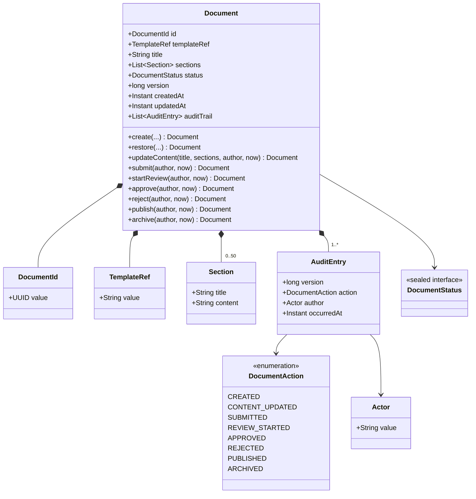
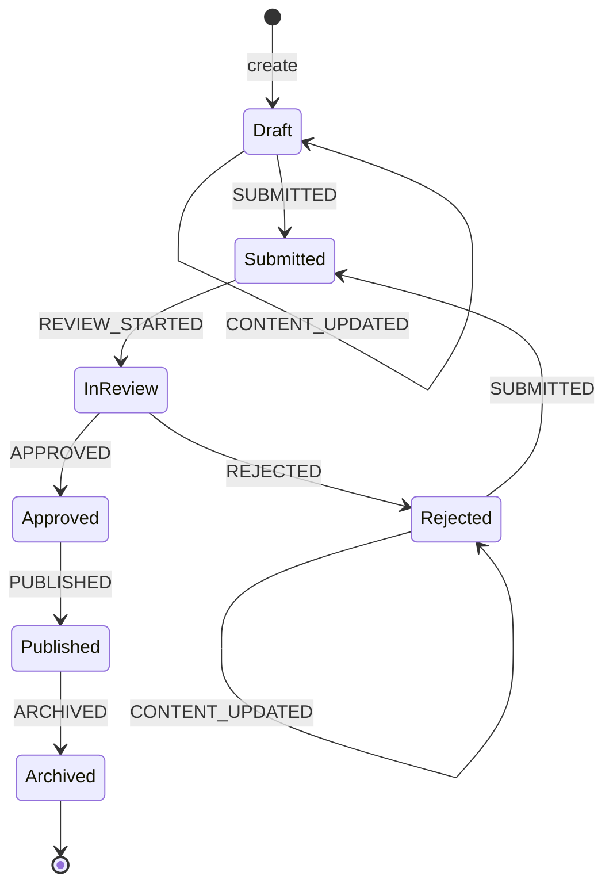

# Domaine

Un agrégat immuable, un état fermé, un audit qui fait partie du document.

## Agrégat

`Document` est `final` et sans setter : chaque action renvoie un nouvel agrégat. Les collections sont copiées (`List.copyOf`).

Les huit actions passent par `DocumentTransition.next(status, action)`, une seule table de transitions : un état ou une action inconnus lèvent `INVALID_TRANSITION`, et rien n'est modifié.

## États

Toute autre combinaison lève `DomainException("INVALID_TRANSITION")` et ne change rien : ni état, ni version, ni audit.

## Invariants

| Invariant | Portée |
|---|---|
| `version` commence à 1, +1 par action réussie | `Document` |
| `auditTrail.size() == version` | `Document.restore` |
| Audit ordonné : `CREATED` en premier, dernière entrée = `updatedAt` | `Document` |
| Le temps ne recule pas | `Document.changed` |
| Soumission : ≥ 1 section, contenu non blanc | `Document.submit` |
| Contenu modifiable seulement en `Draft` ou `Rejected` | `DocumentTransition.next` |
| Instantané de version écrit avec l'état courant, dans la même transaction | persistance, hors domaine |
| Titres ≤ 200, modèle et auteur ≤ 100, contenu ≤ 100 000, ≤ 50 sections | value objects |

## Codes d'erreur métier

| Code | Cause | HTTP |
|---|---|---|
| `INVALID_TRANSITION` | Action interdite pour l'état | 409 |
| `EMPTY_DOCUMENT` | Soumission sans section valide | 409 |
| `NON_MONOTONIC_TIME` | Instant antérieur à `updatedAt` | 409 |

## Ce qui n'est pas du domaine

Les instantanés de version (`document_versions`) sont une projection de persistance : le domaine ne connaît que son audit. Aucun code métier ne lit une version stockée, il ne fait que l'afficher.

## Couverture exigée

100 % des branches et des lignes de `domain` et `application` (JaCoCo, échec du build sinon), dont toute la machine à états.
