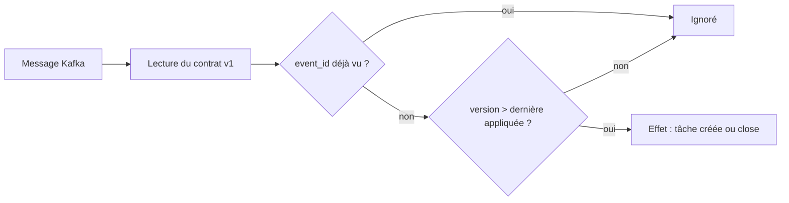

# Contexte review — S8

Service qui transforme les événements de cycle de vie d'un document en tâches de revue.

```
./mvnw -pl review-service verify     # tests unitaires + IT Kafka/PostgreSQL (Docker requis)
make review-run                      # infra puis service sur 127.0.0.1:8082
```

Il consomme `acd.document.lifecycle.v1`, ouvre une tâche à la soumission, la clôt à l'approbation ou au rejet, et expose `GET /api/review-tasks?state=PENDING`.

## Responsabilités

| Le service fait | Le service ne fait pas |
|---|---|
| Créer et clore des tâches de revue | Décider du statut d'un document |
| Ignorer un événement déjà traité (inbox) | Réécrire l'historique du document |
| Refuser un événement plus ancien que le dernier appliqué | Rejouer le cycle de vie |
| Envoyer un message illisible en `DLT` | Corriger le producteur |

Le propriétaire de l'état du document reste `contribution-service`. Voir [ADR 0005](../docs/adr/0005-review-context-ownership.md).

## Persistance

Trois tables dans le schéma PostgreSQL `review` :

| Table | Rôle |
|---|---|
| `review_inbox` | identifiants d'événements déjà traités |
| `review_documents` | dernière version appliquée par document |
| `review_tasks` | une tâche par version soumise, `PENDING` puis `APPROVED` ou `REJECTED` |

Le schéma est créé par Liquibase, `connection-init-sql` le garantissant avant la table de suivi de Liquibase. Le kata partage l'instance PostgreSQL avec `contribution-service` et sépare les tables par schéma ; une topologie réelle donnerait une base par service.

## Idempotence



Chaque garde est une instruction SQL unique (`ON CONFLICT`), donc deux consommateurs simultanés ne peuvent pas appliquer deux fois le même événement.

## Erreurs

Deux tentatives pour une panne transitoire, puis `DLT` (`<topic>.DLT`, même partition). Un message dont le `schemaVersion` diffère de 1, ou dont un champ obligatoire manque, va directement en `DLT` : il ne deviendra jamais lisible.
